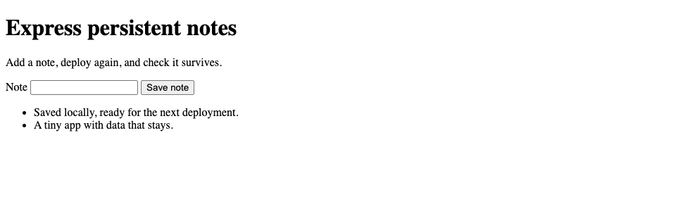

# Node.js + SQLite: persistent notes

An Express app with a plain HTML frontend and Node's built-in SQLite. Save a note, restart the app, and see the same note. There is no bundler or separate database service.



## Run locally

Requires Node.js 22.13 or newer; Node.js 24 LTS is recommended.

```sh
git clone https://github.com/weeny-cloud/examples.git
cd examples/node-sqlite
npm ci
WEENY_DATA_DIR="$HOME/.local/share/weeny-examples/node-sqlite" npm start
```

Open http://127.0.0.1:3000. Save a note, stop with Ctrl+C, then run the same start command again. The database is `app.db` in your chosen data directory. Set `PORT` to use another local port.

`node check.mjs http://127.0.0.1:3000` checks the frontend, API, valid input and a saved note. After restarting, add `--read-only` to verify that note remains. Notes older than 30 days are removed by an hourly cleanup job.

## Deploy to Weeny

Check [free hosting availability](https://weeny.cloud/free) and [sign in](https://weeny.cloud/login). On your laptop, from the repository root:

```sh
npx weeny-cloud login
npx weeny-cloud
# If you do not already have a server, choose an available offer first.
npx weeny-cloud push ./node-sqlite notes --build "npm ci" -- node server.mjs
npx weeny-cloud ssh "weeny expose notes 3000 --private"
```

Open the URL returned by expose and sign in as the owner. Your server provides `WEENY_DATA_DIR`; do not set it to a release directory. On a shared server, select an unused port and set `PORT` for the app before exposing that same port. For later updates, run `npx weeny-cloud push ./node-sqlite notes` from the repository root.

The app has no own authentication. Private exposure protects personal notes with Weeny access control; public exposure allows anyone to read and add notes. SQLite statements bind user input, and the frontend inserts note text with `textContent`.

## Adapt it

`server.mjs` contains the API and storage; `public/` contains the form. `GET /health` checks the database, `GET /api/notes` lists records, and `POST /api/notes` accepts `{"text":"your note"}`. Durable database: `WEENY_DATA_DIR/app.db`.

See the [full Node + SQLite recipe](https://weeny.cloud/recipes/default) and [other starters](../README.md).
