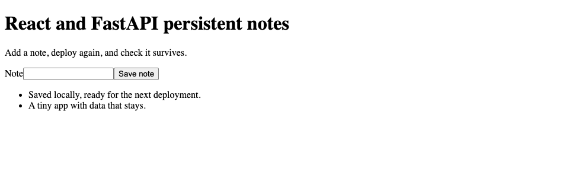

# React + FastAPI: one app, one address

A Vite React frontend served by FastAPI, with SQLite notes outside the code release. The browser calls `/api/notes` on the same origin; no separate API hostname is required.



## Run locally

Requires Node.js 22.22.3 or newer (24 LTS recommended) and Python 3.12 or newer.

```sh
git clone https://github.com/weeny-cloud/examples.git
cd examples/react-fastapi
npm ci
npm run build
python3 -m venv .venv
.venv/bin/pip install -r requirements.txt
WEENY_DATA_DIR="$HOME/.local/share/weeny-examples/react-fastapi" sh run.sh
```

Open http://127.0.0.1:8000. Save a note, stop with Ctrl+C, then repeat the start command. Your note should remain in `notes.sqlite` under the selected data directory. Set `PORT` to change the server port.

For frontend development, run `npm run dev` in a second terminal. Vite proxies `/api` to FastAPI on port 8000. Rebuild with `npm run build` to update the frontend served by Python.

## Deploy to Weeny

Check [free hosting availability](https://weeny.cloud/free), sign in and choose an available server if needed. From the repository root on your laptop:

```sh
npx weeny-cloud login
npx weeny-cloud
npx weeny-cloud push ./react-fastapi react-notes --build "npm ci && npm run build && python3 -m venv .venv && .venv/bin/pip install -r requirements.txt" -- sh run.sh
npx weeny-cloud ssh "weeny expose react-notes 8000 --private"
```

Open the returned URL as the signed-in owner. Weeny supplies a persistent `WEENY_DATA_DIR`. On a shared server, set an unused `PORT` and expose the same port. Deploy updates with `npx weeny-cloud push ./react-fastapi react-notes`.

For a small server, the Vite build can run locally or in CI; see the [1GB deployment patterns](https://weeny.cloud/recipes/teeny). Keep Python dependencies installed on the target Linux server rather than uploading a local virtual environment.

## Adapt it

`src/main.jsx` contains the React form; `app.py` contains the Python API and static frontend serving. Empty, whitespace-only and oversized notes are rejected. Missing frontend assets return 404; HTML client routes receive the React entry page.

There is no app-level login. The instructions use private exposure; public exposure would let anyone read and add notes. Add your own authorization before using this as a public multi-user app.

Read the [complete React + FastAPI recipe](https://weeny.cloud/recipes/react-fastapi) and [other starters](../README.md).
