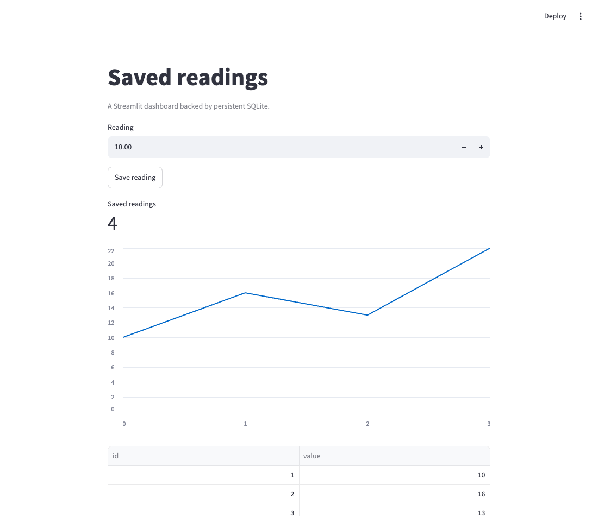

# Streamlit + SQLite: saved readings

An interactive dashboard that keeps saved readings between browser sessions, app restarts and deployments. SQLite stores the readings; Streamlit session state is not used as durable storage.



## Run locally

Requires Python 3.12 or newer.

```sh
git clone https://github.com/weeny-cloud/examples.git
cd examples/streamlit
python3 -m venv .venv
.venv/bin/pip install -r requirements.txt
WEENY_DATA_DIR="$HOME/.local/share/weeny-examples/streamlit" sh run.sh
```

Open http://127.0.0.1:8501. Save a reading, stop with Ctrl+C, and restart with the same command. The reading remains in `readings.db` under the selected data directory. Set `PORT` to use another port.

Run `.venv/bin/python check.py` for an interactive save and a fresh-session persistence check. It uses a disposable database and does not touch your saved readings.

## Deploy to Weeny

Check [free hosting availability](https://weeny.cloud/free) and choose an available server if needed. From the repository root on your laptop:

```sh
npx weeny-cloud login
npx weeny-cloud
npx weeny-cloud push ./streamlit readings --build "python3 -m venv .venv && .venv/bin/pip install -r requirements.txt" -- sh run.sh
npx weeny-cloud ssh "weeny expose readings 8501 --private"
```

Use the hostname returned by expose to configure Streamlit's external address. Open an SSH session with `npx weeny-cloud ssh`, then run this on the server, replacing the example hostname:

```sh
weeny env readings STREAMLIT_BROWSER_SERVER_ADDRESS=YOUR-APP.onweeny.com STREAMLIT_BROWSER_SERVER_PORT=443
```

Visit the HTTPS URL as the signed-in owner and save a reading. This verifies the WebSocket session as well as the initial page. Keep CORS and XSRF protection enabled. On a shared server, choose an unused `PORT` and expose that same port.

Push an update with `npx weeny-cloud push ./streamlit readings` and check the saved reading again. Weeny supplies the persistent `WEENY_DATA_DIR`.

## Adapt it

The dashboard is in `app.py`. There is no app-level login; the deployment instructions use private exposure. Public exposure would allow anyone to view and add readings. Free servers sleep when idle, which can interrupt active sessions and in-process tasks. Choose an always-on plan for continuous jobs, and check memory use before loading large datasets.

See the [full Streamlit deployment recipe](https://weeny.cloud/recipes/streamlit), [all recipes](https://weeny.cloud/recipes), and [other starters](../README.md).
